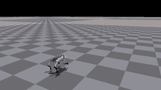
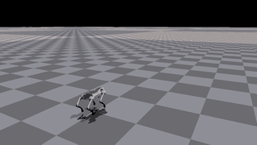
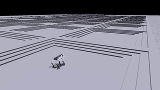

# Unitree Go2 四足机器人复杂地形运动控制

基于 `LeggedGym-Ex` 与 `Isaac Gym`，在 NVIDIA A100 上复现 Unitree Go2 的强化学习运动控制训练、评测和视频记录链路。

> 结果均来自 Isaac Gym 仿真，未做真机部署。

## 结果演进

### 早期：机器人无法稳定行走

早期训练日志中的 reward 看起来正常，但视频里 Go2 开局下沉、坐下或不前进。排查后确认评测端没有真正加载 checkpoint，使用了随机初始化的策略。



### 中期：平地行走链路打通

修复权重加载、观测 command 同步和评测计数后，平地策略通过统一行为门槛：20/20 个 episode 跑满 1000 步，平均前向速度 0.266 m/s，目标速度 0.3 m/s，最低机身高度 0.351 m。



### 后期：8000 迭代粗糙地形策略能够行走

`go2_ts` 在 4096 个并行环境上训练 8000 次迭代，约 7.9 亿环境步。策略已经可以在斜坡、起伏、楼梯和离散障碍地形上持续行走，并完成部分台阶攀爬；但跨全部地形保持低摔倒率仍未达到目标，因此该 checkpoint 作为当前能力基线，不宣称为全地形鲁棒策略。



完整视频见 [Hugging Face 视频仓库](https://huggingface.co/A2bao/go2-quadruped-locomotion/tree/main/videos)。

## 当前结论

| 阶段 | 结论 |
|---|---|
| 环境自举 | Python 3.8、PyTorch 2.4.1+cu121、Isaac Gym Preview 4 在 A100 上跑通 |
| 平地训练与评测 | 已验证通过 |
| 粗糙地形 8000 迭代 | 能行走，但不同地形能力差异明显 |
| 分档课程实验 | 已完成，暴露出固定档位训练泛化不足 |
| 下一步 | 暂停继续训练，转向近期 HIM、HACL、ABS 等方法调研 |

## 关键工程问题

项目重点不是简单运行 PPO，而是建立了完整的训练到评测闭环，并定位了多项真实故障：

- 评测 runner 未加载 checkpoint，导致视频使用随机策略
- command 写入环境后没有同步到 observation
- 训练环境数被评测环境数覆盖，导致 manifest 记录错误
- 评测手动设置出生点，造成机器人嵌入或悬空后立即摔倒
- 评测 episode 计数未清零，导致通过率被误判为 0%
- 地形等级存在负索引，多个环境被错误放到同一地块
- 内置课程的升降阈值对称，表现更接近随机游走而不是“学会后升级”
- 评测没有限制横向越界，机器人跑到地形外的平地并虚增行走距离

完整的“现象 → 证据 → 根因 → 修复”记录见 [`docs/05-debug-log.md`](docs/05-debug-log.md)。

## 技术栈

| 项目 | 配置 |
|---|---|
| 机器人 | Unitree Go2 |
| 仿真器 | Isaac Gym Preview 4 / 1.0rc4 |
| 训练框架 | LeggedGym-Ex，commit `09283fe0e768274feb79eacacd72f1dd4175c142` |
| 算法 | rsl_rl PPO、privileged teacher-student 变体 |
| 训练资源 | NVIDIA A100-SXM4-80GB |
| 并行环境 | 4096 |
| 训练环境 | Python 3.8、PyTorch 2.4.1+cu121 |

## 评测地形

地形网格为 10 行 × 10 列。行表示难度档位，列表示地形类型：

| 地形列 | 类型 |
|---|---|
| 0、1 | 平滑斜坡 |
| 2 | 随机起伏 |
| 3、4、5 | 楼梯方向 A |
| 6、7 | 楼梯方向 B |
| 8、9 | 离散障碍 |

评测从指定档位开始，沿环境的 +X 方向行走，记录净位移、到达档位、最低机身高度、横向偏差和退出原因。评测脚本不会把跑到外围平地的距离计入有效结果。

## 仓库结构

```text
docs/       规格、方案、平台适配和故障记录
scripts/    训练、评测、录制和环境脚本
configs/    Go2 配置快照
results/    训练与评测日志、CSV、summary
media/      README GIF 与视频索引
packages/   历史提交包、启动命令和 SHA256
```

上游 `LeggedGym-Ex` 源码和 Isaac Gym 安装包不包含在仓库中，请按固定 commit 和项目文档准备环境。

## 快速开始

平台上传任务包后，代码自动解压到 `/code/workspace`，按包索引中的命令启动：

```bash
bash /code/workspace/scripts/train_eval_record_job.sh
bash /code/workspace/scripts/eval_level_sweep_entry.sh
```

训练 checkpoint、日志、CSV 和视频分别保存到 `/data/proj1/runs/`、`/data/proj1/results/` 和 `/data/proj1/media/`。

## 资料

- [项目总结与过程记录](docs/06-project-summary.md)
- [完整故障排查记录](docs/05-debug-log.md)
- [视频索引](media/INDEX.md)
- [结果目录说明](results/README.md)
- [提交包索引](packages/INDEX.md)
- [Hugging Face 视频与资产](https://huggingface.co/A2bao/go2-quadruped-locomotion)

## 免责声明

所有指标和视频均为仿真结果，不代表真实 Go2 的安全性能，也不构成真机部署建议。
